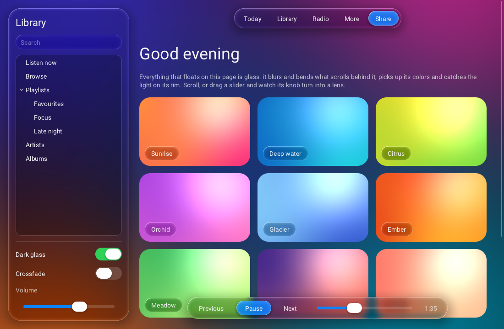
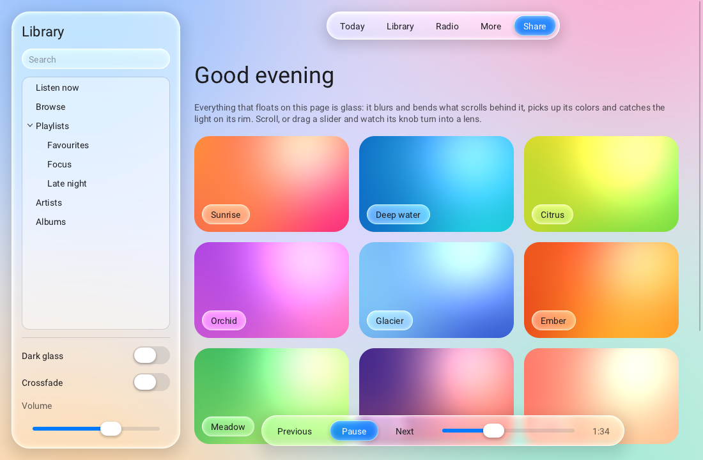

# Raven

A lightweight, multithreaded GUI library in C for editors and tools.

- **C11, no dependency.** Raven opens its own windows (Win32, X11) and loads
  Vulkan at run time. A stripped shared library is about 630 KB, font included.
- **Slate-style layout.** Vertical / horizontal boxes, grid, uniform grid,
  overlay, border, size box, canvas, scroll box, splitter, wrap box,
  switcher, tabs, expander. Each child carries a *slot* (padding, alignment,
  auto or fill size) read by its parent.
- **Windows written in XML**, or built with the C API, or both.
- **Viewports** for content rendered by the application: a texture (zero-copy
  Vulkan image, shared memory for OpenGL, or CPU pixels), a draw callback
  inside the render pass of Raven, or a native child window for any API.
- **Multithreaded.** A render thread owns the GPU, a job system paints large
  trees in parallel and runs your asynchronous work, textures decode in the
  background. The UI thread never waits for the GPU except for back-pressure.
- **Vulkan renderer behind an interface.** The UI is one instanced draw of
  signed-distance primitives per texture change; another backend (OpenGL,
  HRL...) is a table of ten functions.
- **Glass.** Two themes in the spirit of the "Liquid Glass" of iOS 26:
  controls and panels blur and refract what is behind them, reflect what is
  around them and catch the light on their rim; switches, sliders and buttons
  are animated.
- **Opaque handles** in the style of HRL: every object is a `Rid`,
  validated on every call, with errors reported through a callback.
- **One header**: `#include <Raven.h>`.



*`examples/glass`: the dark glass theme. The side bar, the two floating bars and every control are glass over a page that scrolls under them.*



*The same window with `R_THEME_GLASS_LIGHT`.*


*`examples/editor`: a window described in XML, rendered by the Vulkan backend, with the flat dark theme.*

```c
#include <Raven.h>

static void on_clicked(Rid button, void* user) { Rquit(0); }

int main(void) {
    Rinit(R_BACKEND_VULKAN);

    Rid window = Rwindow_create("Hello", 420, 220, R_WINDOW_DEFAULT);
    Rid box = Rwidget_create(R_WIDGET_VBOX);
    Rpanel_set_spacing(box, 12);
    Rslot_set_halign(box, R_HALIGN_CENTER);
    Rslot_set_valign(box, R_VALIGN_CENTER);
    Rwindow_set_content(window, box);

    Rwidget_add_child(box, Rlabel_create("Hello from Raven"));
    Rid button = Rwidget_add_child(box, Rbutton_create("Quit"));
    Rbutton_set_clicked_callback(button, on_clicked, NULL);

    Rrun();          /* event-driven: sleeps when nothing changes */
    Rshutdown();
    return 0;
}
```

The same window in XML (`Rwindow_create_from_xml_file("hello.xml")`):

```xml
<Window Title="Hello" Width="420" Height="220">
    <VBox Spacing="12" Slot.HAlign="Center" Slot.VAlign="Center">
        <Label>Hello from Raven</Label>
        <Button Text="Quit" OnClicked="app.quit"/>
    </VBox>
</Window>
```

## Status

Version 0.1. What has been verified, and what has not:

| | State |
|---|---|
| Layout, widgets, XML, threading | 4 headless test programs; no report from AddressSanitizer, UBSan or ThreadSanitizer in Raven code |
| Vulkan renderer | pixel tests (`test_render`), examples; run on a software Vulkan driver (SwiftShader) |
| Glass themes | pixel tests of the blur and of the rim, the `glass` example and the editor with all four themes; same software driver only, so the cost on a real GPU was not measured |
| Linux / X11 | run under Xvfb with real pointer and keyboard events, clipboard, resize, native child window, OpenGL (llvmpipe) |
| Windows / Win32 | every file passes clang's syntax and type checking against the mingw-w64 headers without a warning, but nothing was **linked or run** on Windows. Expect to fix details on the first run; the code to look at is `src/platform/win32/win32_platform.c` |
| MSVC | not compiled. The code avoids GNU extensions and has an MSVC path for atomics, but `/W4` may report warnings |
| `build.bat`, `generate-cmake.bat` | written without a Windows machine: never run |
| A real GPU | not tested: no hardware driver and no validation layers were available. Run the examples in a Debug build (it enables the validation layers) before trusting it |
| macOS, Wayland | not implemented (XWayland works through the X11 platform) |

## Building

Requirements: CMake 3.16+, a C11 compiler. Linux also needs the X11
development package (`libx11-dev`). The Vulkan *headers* are needed to build;
they come from the Vulkan SDK when it is installed and are downloaded
otherwise. No Vulkan library is linked.

```sh
cmake -S . -B build -DCMAKE_BUILD_TYPE=Release
cmake --build build --config Release
cd build && ctest -C Release --output-on-failure
```

The programs are written to `build/bin` (`build\bin\Release` with Visual
Studio), next to `raven.dll` in a shared build.

On Windows, two scripts do the same from the folder of Raven:

```bat
generate-cmake.bat            :: creates build\raven.sln (the newest Visual Studio installed)
generate-cmake.bat --open     :: ... and opens it; F5 starts the editor example
build.bat                     :: Release build (generates the build tree if needed)
build.bat debug --test        :: Debug build, then the tests
build.bat --run glass         :: builds, then starts an example
```

`generate-cmake.bat --help` and `build.bat --help` list their options
(`--shared`, `--generator Ninja`, `--build-dir`, `--fresh`, ...). CMake
options go after `--`: `generate-cmake.bat -- -DRAVEN_WARNINGS_AS_ERRORS=ON`.

| Option | Default | |
|---|---|---|
| `RAVEN_BUILD_SHARED` | `OFF` | shared library instead of static |
| `RAVEN_BUILD_EXAMPLES` | `ON` when top level | |
| `RAVEN_BUILD_TESTS` | `ON` when top level | tests and `raven_benchmark` |
| `RAVEN_BACKEND_VULKAN` | `ON` | `OFF` builds without any GPU code (custom backend or headless) |
| `RAVEN_PLATFORM` | `auto` | `win32`, `x11` or `null` |
| `RAVEN_WITH_STB_IMAGE` | `ON` | PNG / JPEG / BMP / TGA decoding |
| `RAVEN_FETCH_VULKAN_HEADERS` | `ON` | download the Khronos headers when no SDK is found |
| `RAVEN_VULKAN_INCLUDE_DIR` | | folder containing `vulkan/vulkan.h`, to skip the search |
| `RAVEN_REBUILD_SHADERS` | `OFF` | recompile the GLSL (needs `glslangValidator` or `glslc`); the SPIR-V is committed |
| `RAVEN_WARNINGS_AS_ERRORS` | `OFF` | |

Using it from another CMake project:

```cmake
add_subdirectory(raven)                       # or find_package(raven) after an install
target_link_libraries(app PRIVATE raven::raven)
```

## Examples

| | |
|---|---|
| `examples/hello` | a window with the C API |
| `examples/editor` | a scene editor described in `editor.xml`: menus, splitters, tree, tabs, property grid, a viewport rendered in software on the job system, a custom-drawn graph, a virtual list. Its View menu switches between the four themes |
| `examples/glass` | the glass themes: a page of cards scrolling under a side bar, a tool bar and a player bar made of glass, glass menu, animated switches and sliders. `raven_glass light` starts with the light glass |
| `examples/viewport_vulkan` | a Vulkan scene in the UI, twice: offscreen image wrapped as a texture, and drawn in the render pass of Raven. Needs the Vulkan library |
| `examples/viewport_opengl` | an OpenGL scene in a native child window (WGL / GLX) |


*`examples/viewport_vulkan`: the same scene as a wrapped image (left) and drawn inside the render pass of Raven (right), with widgets on top.*

## Concepts

### Names

`#include <Raven.h>` gives the whole API; the headers it includes
(`raven/raven_window.h`, `raven/raven_controls.h`...) can also be included
one by one.

| | | |
|---|---|---|
| functions | `R<object>_<action>` | `Rwindow_create`, `Rwindow_get_size`, `Rbutton_set_text`, `Rslot_set_padding` |
| library functions | `R<action>` | `Rinit`, `Rrun`, `Rupdate`, `Rquit`, `Rshutdown` |
| types | `R<Name>` | `Rid`, `REvent`, `RInitDesc`, `RPainter`; callbacks end with `Callback` |
| constants | `R_<NAME>` | `R_INVALID_ID`, `R_WIDGET_VBOX`, `R_KEY_ESCAPE`, `R_THEME_GLASS_DARK` |
| build options and macros | `RAVEN_<NAME>` | `RAVEN_BUILD_SHARED`, `RAVEN_API`, `RAVEN_VERSION_MAJOR` |

Names that do not start this way (`rvn_...`, `RVN_...`) are internal to the
library and are not exported.

### Handles and errors

Every object is a `Rid`. Handles carry a generation, so using a deleted
object is detected and reported instead of crashing. Deleting a widget
deletes its children; deleting a window deletes its content.

```c
static void on_error(RError code, RSeverity severity, const char* detail) {
    fprintf(stderr, "%s: %s\n", Rerror_to_string(code), detail);
}
Rerror_set_callback(on_error);
```

### Layout

Layout is the two passes of Slate: each widget computes the size it would
like, bottom-up, then each panel gives a rectangle to its children, top-down.
How a child is placed is stored on the child, in its slot:

```c
Rid row = Rwidget_add_child(parent, Rwidget_create(R_WIDGET_HBOX));
Rid name = Rwidget_add_child(row, Rwidget_create(R_WIDGET_TEXT_INPUT));
Rslot_set_fill(name, 1.0f);                   /* takes the free width          */
Rid ok = Rwidget_add_child(row, Rbutton_create("OK"));
Rslot_set_valign(ok, R_VALIGN_CENTER);      /* its own height, centered      */
Rslot_set_padding(ok, 8, 0, 0, 0);
```

Sizes are logical units, multiplied by the scale of the monitor. Only the
part of the tree that changed is measured and arranged again.

### XML

Tags are widget types, attributes are properties, `Slot.*` attributes are
the slot. `On...` attributes name *actions*, bound from C with
`Raction_bind`. The full reference is [docs/XML.md](docs/XML.md).

### Threads

- The thread that calls `Rinit` is the **UI thread**. Every function is
  called from it, except the few documented as thread-safe (`Rtask_post`,
  `Rtask_run_async`, `Rwake_up`, `Rquit`, `Rwindow_request_redraw`,
  `Rget_time`).
- From another thread, change the UI by posting a task:
  `Rtask_post(function, data)` runs `function` on the UI thread.
- `Rtask_run_async` and `Rparallel_for` run your work on the worker threads.
- `Rtexture_create_from_file_async` decodes in the background; the widgets
  that use the texture update when it is ready.
- Viewport draw callbacks run on the **render thread**.

### Viewports

```c
/* 1. texture: any image, shown like a widget (clipped, UI on top) */
Rviewport_set_texture(viewport, texture);
/*    Vulkan, zero copy:   Rvulkan_texture_create_from_image_view(view, 0, w, h)
      OpenGL, zero copy:   Rvulkan_texture_create_shared + GL_EXT_memory_object
      anything, one copy:  Rtexture_update(texture, rgba, w, h)             */

/* 2. draw callback: your Vulkan draw calls in the render pass of the window */
Rviewport_set_draw_callback(viewport, on_draw, user);

/* 3. native child window: a HWND / X11 Window for OpenGL, Direct3D, anything */
Rviewport_set_native(viewport, R_TRUE);
Rviewport_get_native_handle(viewport, &native);
```

To render the UI with the device of an engine instead of a device created
by Raven, call `Rvulkan_set_external_device` (and
`Rvulkan_set_queue_lock_callbacks`) before `Rinit`: see `raven_vulkan.h`.

### Theme

`Rtheme_apply` chooses one of four themes: `R_THEME_DARK`, `R_THEME_LIGHT`,
`R_THEME_GLASS_DARK`, `R_THEME_GLASS_LIGHT`. Then any color or metric
can be changed globally (`Rtheme_set_color`, `Rtheme_set_metric`) or for
one widget (`Rwidget_set_color`, `Rwidget_set_metric`, or `Color.Accent="..."`
in XML). Fonts are TrueType files (`Rfont_create_from_file`,
`Rtheme_set_font`, `Rfont_set_fallback`); a subset of Roboto covering
Latin-1 and Latin Extended-A is embedded.

### Glass

```c
Rtheme_apply(R_THEME_GLASS_DARK);          /* before creating the windows */
```

With a glass theme, every control is a piece of glass: buttons and inputs
are capsules that show a blurred, more vivid version of what is behind them,
their rim bends it like a lens, reflects the colors around and catches a
light placed at the top left. Menus and popups are frosted panels, tabs
become a segmented control, a switch is a capsule with a knob that slides,
and the knob of a slider turns into a clear lens while it is dragged.
Hovering, pressing and toggling are animated.

Glass needs something behind it:

- the theme gives every window a soft colored wallpaper;
  `Rwindow_set_background(window, texture)` replaces it with an image
  (`<Window Background="wallpaper.png">`), and a window with a clear color
  (`Rwindow_set_clear_color`, `ClearColor="..."`) has none;
- panels are glass when asked: `Rborder_set_material(border, R_MATERIAL_GLASS)`
  or `<Border Material="Glass" CornerRadius="28" Shadow="24">`. Put one in an
  `Overlay` above a `ScrollBox` to get a bar that floats over the content;
- a custom widget draws glass with `Rdraw_glass`.

The colors of the glass are the usual color roles: with a glass theme their
alpha is the strength of the tint (`Color.Panel="#FF2D5540"` is pink glass).
A glass panel also works with the flat themes, whose panel color is opaque:
give it a translucent `Background`.

How it is rendered: a frame that contains glass is drawn into an offscreen
image; where glass begins, what has been drawn so far is copied and blurred
(three half-size reductions and back), and the glass primitives sample both
the sharp and the blurred copy. Glass over glass works (a button on a glass
bar sees the bar). Only the first copy of a frame covers the window; the
next ones are limited to the area that changed under the glass, and glass
over something that is already in the copy costs none.
`RFrameStats::backdrop_count` tells how many a frame needed (13 in the
`glass` example, 24 at most). A frame without glass is drawn straight to the
window, as before: the flat themes cost nothing more.
[docs/ARCHITECTURE.md](docs/ARCHITECTURE.md) has the details.

### Custom widgets and custom backends

A `R_WIDGET_CUSTOM` widget is measured and painted by two callbacks using
the `Rdraw_...` functions (`raven_draw.h`). A rendering backend is a
`RBackendVTable` (`raven_backend.h`) given to `Rbackend_register`;
`src/render/null/null_backend.c` is a template.

## Performance

`raven_benchmark` (built with the tests) measures a large tree without a GPU.
On the 2-core virtual machine used for development, release build:

| 12 000 widgets, 27 800 primitives | |
|---|---|
| first layout | 2 to 3 ms |
| full repaint | 1.3 to 2.3 ms, one draw call |
| layout after changing one label | 0.03 to 0.05 ms |

Parallel painting made little difference on that machine (two cores shared
with the render thread); measure on yours with `raven_benchmark 160 0` against
`raven_benchmark 160 -1`. A typical editor window has a few thousand widgets
and repaints in a fraction of a millisecond; nothing is recomputed or drawn
while nothing changes.

The glass themes were only run on a software Vulkan driver (SwiftShader, two
cores), where a frame of the `glass` example takes about 250 ms at 1100 x 720.
That measures the CPU rasterizer, not the design: on a GPU the cost is the
blur passes described above, but it has not been measured. Read
`RFrameStats::render_ms` and `backdrop_count` on your machine.

## Layout of the repository

```
include/Raven.h      the whole public API in one include
include/raven/       ... one header per area
src/core/            memory, handles, threads, job system, lock-free map, main loop
src/platform/        window systems behind one interface: win32/, x11/, null/
src/render/          draw lists, fonts and glyph atlas, textures, render thread
src/render/vulkan/   the Vulkan backend and its shaders (vk_glass.c: backdrop blur)
src/widget/          widget base: tree, layout, events, painting, windows, style
src/widgets/         one file per widget type
src/xml/             XML parser, attributes, loader
examples/  tests/  docs/  cmake/  tools/  third_party/
build.bat  generate-cmake.bat
```

[docs/ARCHITECTURE.md](docs/ARCHITECTURE.md) explains how the pieces work
and how to add a widget, a window system or a backend.

## Not implemented yet

macOS and native Wayland; text kerning, right-to-left and complex scripts;
IME composition window placement; multi-line text editing; drag and drop
from the OS; docking; mipmaps for scaled-down images; a GPU memory
sub-allocator (each texture has its own allocation); a depth buffer in the
draw-callback viewport (render to a texture when you need one); presenting
several windows in one call (windows that redraw continuously each wait for
their own vertical blank on the single render thread); recovery from a lost
Vulkan device; glass over a native child window (it is another window of the
OS: use a texture or a draw-callback viewport under glass).

## Third-party code

`stb_truetype` and `stb_image` (public domain / MIT, Sean Barrett) and a
subset of the Roboto font (Apache 2.0, Google) are included under
`third_party/`; see [THIRD_PARTY.md](THIRD_PARTY.md). The Vulkan headers
(Apache 2.0 / MIT, Khronos) are needed to build but are not part of this
repository.
