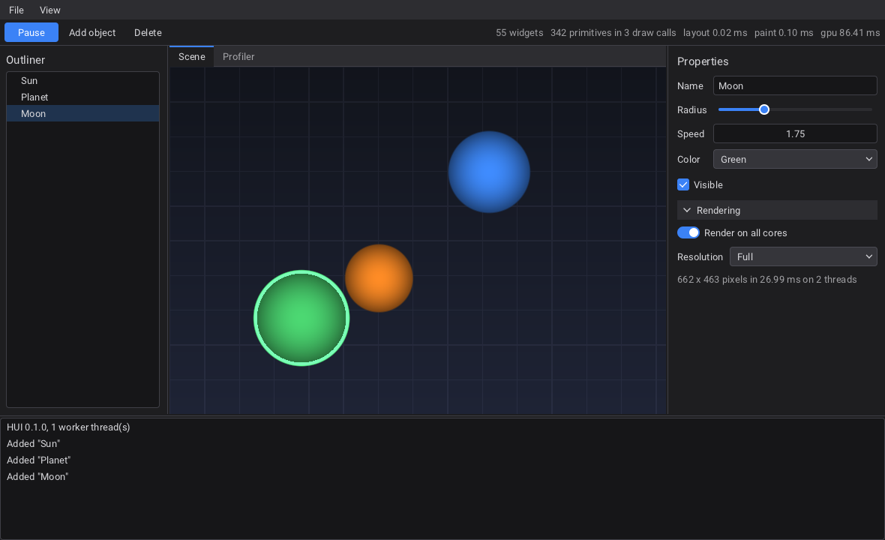
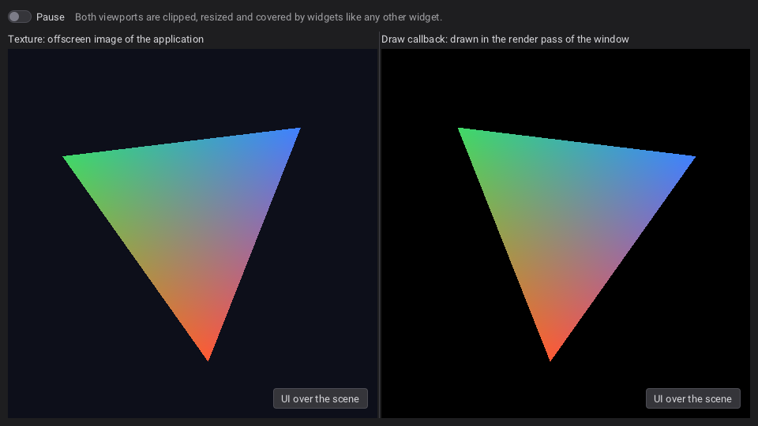

# HUI - Horizon UI

A lightweight, multithreaded GUI library in C for editors and tools.

- **C11, no dependency.** HUI opens its own windows (Win32, X11) and loads
  Vulkan at run time. A stripped shared library is about 600 KB, font included.
- **Slate-style layout.** Vertical / horizontal boxes, grid, uniform grid,
  overlay, border, size box, canvas, scroll box, splitter, wrap box,
  switcher, tabs, expander. Each child carries a *slot* (padding, alignment,
  auto or fill size) read by its parent.
- **Windows written in XML**, or built with the C API, or both.
- **Viewports** for content rendered by the application: a texture (zero-copy
  Vulkan image, shared memory for OpenGL, or CPU pixels), a draw callback
  inside the render pass of HUI, or a native child window for any API.
- **Multithreaded.** A render thread owns the GPU, a job system paints large
  trees in parallel and runs your asynchronous work, textures decode in the
  background. The UI thread never waits for the GPU except for back-pressure.
- **Vulkan renderer behind an interface.** The UI is one instanced draw of
  signed-distance primitives per texture change; another backend (OpenGL,
  HRL...) is a table of ten functions.
- **Opaque handles** in the style of HRL: every object is a `HUI_id`,
  validated on every call, with errors reported through a callback.



*`examples/editor`: a window described in XML, rendered by the Vulkan backend.*

```c
#include <hui/hui.h>

static void on_clicked(HUI_id button, void* user) { HUI_Quit(0); }

int main(void) {
    HUI_Init(HUI_BACKEND_VULKAN);

    HUI_id window = HUI_CreateWindow("Hello", 420, 220, HUI_WINDOW_DEFAULT);
    HUI_id box = HUI_CreateWidget(HUI_WIDGET_VBOX);
    HUI_SetPanelSpacing(box, 12);
    HUI_SetSlotHAlign(box, HUI_HALIGN_CENTER);
    HUI_SetSlotVAlign(box, HUI_VALIGN_CENTER);
    HUI_SetWindowContent(window, box);

    HUI_AddChild(box, HUI_CreateLabel("Hello from HUI"));
    HUI_id button = HUI_AddChild(box, HUI_CreateButton("Quit"));
    HUI_SetButtonClickedCallback(button, on_clicked, NULL);

    HUI_Run();          /* event-driven: sleeps when nothing changes */
    HUI_Shutdown();
    return 0;
}
```

The same window in XML (`HUI_CreateWindowFromXmlFile("hello.xml")`):

```xml
<Window Title="Hello" Width="420" Height="220">
    <VBox Spacing="12" Slot.HAlign="Center" Slot.VAlign="Center">
        <Label>Hello from HUI</Label>
        <Button Text="Quit" OnClicked="app.quit"/>
    </VBox>
</Window>
```

## Status

Version 0.1. What has been verified, and what has not:

| | State |
|---|---|
| Layout, widgets, XML, threading | 4 headless test programs; no report from AddressSanitizer, UBSan or ThreadSanitizer in HUI code |
| Vulkan renderer | pixel tests (`test_render`), examples; run on a software Vulkan driver (SwiftShader) |
| Linux / X11 | run under Xvfb with real pointer and keyboard events, clipboard, resize, native child window, OpenGL (llvmpipe) |
| Windows / Win32 | every file passes clang's syntax and type checking against the mingw-w64 headers without a warning, but nothing was **linked or run** on Windows. Expect to fix details on the first run; the code to look at is `src/platform/win32/win32_platform.c` |
| MSVC | not compiled. The code avoids GNU extensions and has an MSVC path for atomics, but `/W4` may report warnings |
| A real GPU | not tested: no hardware driver and no validation layers were available. Run the examples in a Debug build (it enables the validation layers) before trusting it |
| macOS, Wayland | not implemented (XWayland works through the X11 platform) |

## Building

Requirements: CMake 3.16+, a C11 compiler. Linux also needs the X11
development package (`libx11-dev`). The Vulkan *headers* are needed to build;
they come from the Vulkan SDK when it is installed and are downloaded
otherwise. No Vulkan library is linked.

```sh
cmake -S . -B build -DCMAKE_BUILD_TYPE=Release
cmake --build build --config Release
cd build && ctest -C Release --output-on-failure
```

| Option | Default | |
|---|---|---|
| `HUI_BUILD_SHARED` | `OFF` | shared library instead of static |
| `HUI_BUILD_EXAMPLES` | `ON` when top level | |
| `HUI_BUILD_TESTS` | `ON` when top level | tests and `hui_benchmark` |
| `HUI_BACKEND_VULKAN` | `ON` | `OFF` builds without any GPU code (custom backend or headless) |
| `HUI_PLATFORM` | `auto` | `win32`, `x11` or `null` |
| `HUI_WITH_STB_IMAGE` | `ON` | PNG / JPEG / BMP / TGA decoding |
| `HUI_FETCH_VULKAN_HEADERS` | `ON` | download the Khronos headers when no SDK is found |
| `HUI_VULKAN_INCLUDE_DIR` | | folder containing `vulkan/vulkan.h`, to skip the search |
| `HUI_REBUILD_SHADERS` | `OFF` | recompile the GLSL (needs `glslangValidator` or `glslc`); the SPIR-V is committed |
| `HUI_WARNINGS_AS_ERRORS` | `OFF` | |

Using it from another CMake project:

```cmake
add_subdirectory(hui)                       # or find_package(hui) after an install
target_link_libraries(app PRIVATE hui::hui)
```

## Examples

| | |
|---|---|
| `examples/hello` | a window with the C API |
| `examples/editor` | a scene editor described in `editor.xml`: menus, splitters, tree, tabs, property grid, a viewport rendered in software on the job system, a custom-drawn graph, a virtual list |
| `examples/viewport_vulkan` | a Vulkan scene in the UI, twice: offscreen image wrapped as a texture, and drawn in the render pass of HUI. Needs the Vulkan library |
| `examples/viewport_opengl` | an OpenGL scene in a native child window (WGL / GLX) |



*`examples/viewport_vulkan`: the same scene as a wrapped image (left) and drawn inside the render pass of HUI (right), with widgets on top.*

## Concepts

### Handles and errors

Every object is a `HUI_id`. Handles carry a generation, so using a deleted
object is detected and reported instead of crashing. Deleting a widget
deletes its children; deleting a window deletes its content.

```c
static void on_error(HUI_EError code, HUI_ESeverity severity, const char* detail) {
    fprintf(stderr, "%s: %s\n", HUI_ErrorEnumToString(code), detail);
}
HUI_RegisterErrorCallback(on_error);
```

### Layout

Layout is the two passes of Slate: each widget computes the size it would
like, bottom-up, then each panel gives a rectangle to its children, top-down.
How a child is placed is stored on the child, in its slot:

```c
HUI_id row = HUI_AddChild(parent, HUI_CreateWidget(HUI_WIDGET_HBOX));
HUI_id name = HUI_AddChild(row, HUI_CreateWidget(HUI_WIDGET_TEXT_INPUT));
HUI_SetSlotFill(name, 1.0f);                   /* takes the free width          */
HUI_id ok = HUI_AddChild(row, HUI_CreateButton("OK"));
HUI_SetSlotVAlign(ok, HUI_VALIGN_CENTER);      /* its own height, centered      */
HUI_SetSlotPadding(ok, 8, 0, 0, 0);
```

Sizes are logical units, multiplied by the scale of the monitor. Only the
part of the tree that changed is measured and arranged again.

### XML

Tags are widget types, attributes are properties, `Slot.*` attributes are
the slot. `On...` attributes name *actions*, bound from C with
`HUI_BindAction`. The full reference is [docs/XML.md](docs/XML.md).

### Threads

- The thread that calls `HUI_Init` is the **UI thread**. Every function is
  called from it, except the few documented as thread-safe (`HUI_PostTask`,
  `HUI_RunAsync`, `HUI_WakeUp`, `HUI_Quit`, `HUI_RequestWindowRedraw`,
  `HUI_GetTime`).
- From another thread, change the UI by posting a task:
  `HUI_PostTask(function, data)` runs `function` on the UI thread.
- `HUI_RunAsync` and `HUI_ParallelFor` run your work on the worker threads.
- `HUI_CreateTextureFromFileAsync` decodes in the background; the widgets
  that use the texture update when it is ready.
- Viewport draw callbacks run on the **render thread**.

### Viewports

```c
/* 1. texture: any image, shown like a widget (clipped, UI on top) */
HUI_SetViewportTexture(viewport, texture);
/*    Vulkan, zero copy:   HUI_Vulkan_CreateTextureFromImageView(view, 0, w, h)
      OpenGL, zero copy:   HUI_Vulkan_CreateSharedTexture + GL_EXT_memory_object
      anything, one copy:  HUI_UpdateTexture(texture, rgba, w, h)             */

/* 2. draw callback: your Vulkan draw calls in the render pass of the window */
HUI_SetViewportDrawCallback(viewport, on_draw, user);

/* 3. native child window: a HWND / X11 Window for OpenGL, Direct3D, anything */
HUI_SetViewportNative(viewport, HUI_TRUE);
HUI_GetViewportNativeHandle(viewport, &native);
```

To render the UI with the device of an engine instead of a device created
by HUI, call `HUI_Vulkan_SetExternalDevice` (and
`HUI_Vulkan_SetQueueLockCallbacks`) before `HUI_Init`: see `hui_vulkan.h`.

### Theme

`HUI_ApplyTheme(HUI_THEME_DARK / HUI_THEME_LIGHT)`, then any color or metric
can be changed globally (`HUI_SetThemeColor`, `HUI_SetThemeMetric`) or for
one widget (`HUI_SetWidgetColor`, `HUI_SetWidgetMetric`, or `Color.Accent="..."`
in XML). Fonts are TrueType files (`HUI_CreateFontFromFile`,
`HUI_SetThemeFont`, `HUI_SetFontFallback`); a subset of Roboto covering
Latin-1 and Latin Extended-A is embedded.

### Custom widgets and custom backends

A `HUI_WIDGET_CUSTOM` widget is measured and painted by two callbacks using
the `HUI_Draw...` functions (`hui_draw.h`). A rendering backend is a
`HUI_BackendVTable` (`hui_backend.h`) given to `HUI_RegisterBackend`;
`src/render/null/null_backend.c` is a template.

## Performance

`hui_benchmark` (built with the tests) measures a large tree without a GPU.
On the 2-core virtual machine used for development, release build:

| 12 000 widgets, 27 800 primitives | |
|---|---|
| first layout | 2 to 3 ms |
| full repaint | 1.3 to 2.3 ms, one draw call |
| layout after changing one label | 0.03 to 0.05 ms |

Parallel painting made little difference on that machine (two cores shared
with the render thread); measure on yours with `hui_benchmark 160 0` against
`hui_benchmark 160 -1`. A typical editor window has a few thousand widgets
and repaints in a fraction of a millisecond; nothing is recomputed or drawn
while nothing changes.

## Layout of the repository

```
include/hui/       public API, one header per area (hui.h includes them all)
src/core/          memory, handles, threads, job system, lock-free map, main loop
src/platform/      window systems behind one interface: win32/, x11/, null/
src/render/        draw lists, fonts and glyph atlas, textures, render thread
src/render/vulkan/ the Vulkan backend (and its two shaders)
src/widget/        widget base: tree, layout, events, painting, windows, style
src/widgets/       one file per widget type
src/xml/           XML parser, attributes, loader
examples/  tests/  docs/  cmake/  tools/  third_party/
```

[docs/ARCHITECTURE.md](docs/ARCHITECTURE.md) explains how the pieces work
and how to add a widget, a window system or a backend.

## Not implemented yet

macOS and native Wayland; text kerning, right-to-left and complex scripts;
IME composition window placement; multi-line text editing; drag and drop
from the OS; docking; mipmaps for scaled-down images; a GPU memory
sub-allocator (each texture has its own allocation); a depth buffer in the
draw-callback viewport (render to a texture when you need one); presenting
several windows in one call (windows that redraw continuously each wait for
their own vertical blank on the single render thread); recovery from a lost
Vulkan device.

## Third-party code

`stb_truetype` and `stb_image` (public domain / MIT, Sean Barrett) and a
subset of the Roboto font (Apache 2.0, Google) are included under
`third_party/`; see [THIRD_PARTY.md](THIRD_PARTY.md). The Vulkan headers
(Apache 2.0 / MIT, Khronos) are needed to build but are not part of this
repository.
