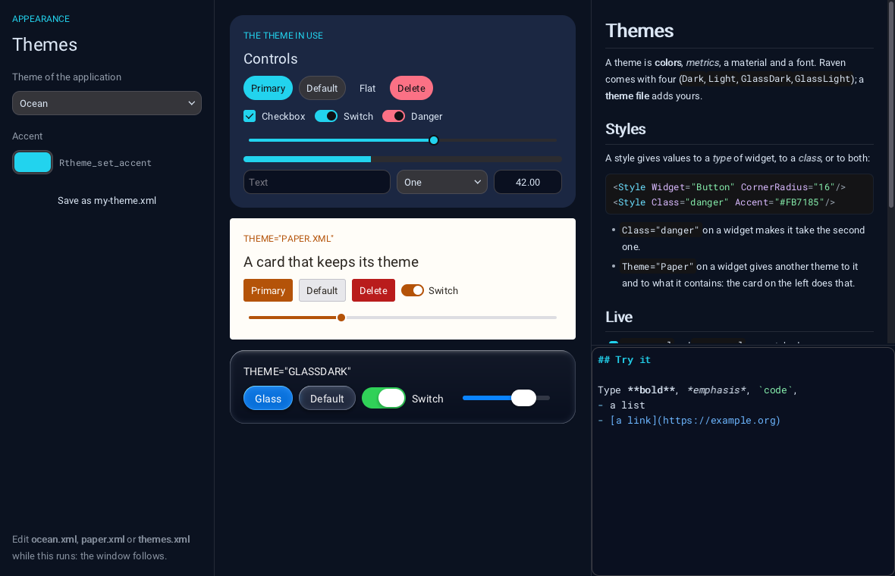

# Themes

A theme is what gives every widget its look: about forty **colors** (roles,
not widgets: "accent", "panel", "text"...), twenty **metrics** (font size,
corner radius, height of a control...), a **material** (solid or one of the
three kinds of glass), a **font**, the colors of **code**, and **styles**:
values for one type of widget, for a class, or for both.

Four themes are built in: `Dark`, `Light`, `GlassDark`, `GlassLight`. The
rest of this page is how to make yours. `examples/themes` shows all of it,
and its files can be edited while it runs.



*`examples/themes`: the theme `ocean.xml` for the application, a card that
keeps the theme `paper.xml`, another one in dark glass; on the right, a
Markdown label and a Markdown editor.*

## From C

```c
Rtheme_apply(R_THEME_DARK);                                /* one of the four                           */
Rtheme_set_accent(0.13f, 0.83f, 0.93f);                    /* the accent and every shade that follows   */
Rtheme_set_color(R_COLOR_PANEL, 0.07f, 0.10f, 0.17f, 1);   /* one color                                 */
Rtheme_set_metric(R_METRIC_CORNER_RADIUS, 10);             /* one metric                                */
Rtheme_set_material(R_MATERIAL_FROSTED_GLASS);             /* what surfaces are made of                 */
```

`Rtheme_set_accent` derives the hovered and pressed shades, the focus
outline, the selection and the links from one color. `Rtheme_set_dark`
tells whether the theme is a dark one (it decides the tint of glass, the
default colors of code and the wallpaper of the glass themes).

For one widget and what it contains: `Rwidget_set_color`,
`Rwidget_set_metric`, `Rwidget_set_material`, or in XML `Color.Accent="#F00"`,
`Metric.CornerRadius="4"`, `Material="Glass"`.

## Styles and classes

A style gives values to the widgets of a type, of a class, or of both:

```c
Rtheme_set_style_metric("Button", NULL, R_METRIC_CORNER_RADIUS, 16);          /* every button         */
Rtheme_set_style_color(NULL, "danger", R_COLOR_ACCENT, 0.98f, 0.44f, 0.52f, 1); /* the class "danger" */
Rtheme_set_style_color("Label", "eyebrow", R_COLOR_TEXT, 0.13f, 0.83f, 0.93f, 1);
Rtheme_set_style_material(NULL, "card", R_MATERIAL_TINTED_GLASS);
```

A widget has any number of classes, separated by spaces: `Class="card
danger"` in XML, `Rwidget_set_class`, `Rwidget_add_class`,
`Rwidget_remove_class`, `Rwidget_has_class` in C. Changing the classes of a
widget changes its look at once, which makes them a simple way to show a
state (`Rwidget_add_class(field, "invalid")`).

When several styles give the same value to a widget, a style with a type and
a class wins over one with a class, which wins over one with a type; between
equals, the last one set wins. What was given to the widget itself
(`Rwidget_set_color`, `Color.*`) wins over every style.

Colors and metrics are inherited by what a widget contains only when they
are set on the widget (`Rwidget_set_color`); a style applies to the widgets
it names, not to their children, except the color of text, which every
widget takes from the nearest ancestor that has one.

## Theme files

```xml
<Theme Name="Ocean" Base="Dark" Accent="#22D3EE" CornerRadius="10">
    <Colors Window="#0B1220" Panel="#111A2C" Text="#DCE7F5" Separator="#FFFFFF1A"/>
    <Metrics ControlHeight="32" Spacing="8"/>
    <Glass Frost="0.8" Refraction="1.2" Saturation="1.1" Rim="1" Shadow="1"/>
    <Syntax Keyword="#7DD3FC" String="#86EFAC" Comment="#64748B" Heading="#22D3EE"/>

    <Style Widget="Button" CornerRadius="16"/>
    <Style Class="danger" Accent="#FB7185" AccentHovered="#FDA4AF" AccentPressed="#E11D48"/>
    <Style Class="card" Panel="#1B2742" CornerRadius="18" Material="Solid"/>
    <Style Widget="Label" Class="eyebrow" Text="#22D3EE" FontSize="12"/>
</Theme>
```

| On `<Theme>` | |
|---|---|
| `Name` | the name the theme is kept under (default: the name of the file) |
| `Base` | the theme it starts from: `Dark` (default), `Light`, `GlassDark`, `GlassLight`, or a theme loaded before |
| `Accent` | the accent color, and the shades derived from it |
| `Material` | `Solid`, `Glass`, `FrostedGlass`, `TintedGlass` |
| `Dark` | `true` / `false`, when the base does not say it right |
| `Font` | a font file, relative to the theme file |
| `Wallpaper` | what is behind the content of the windows (what glass refracts): an image file, `Dark` or `Light` (the soft ones of the glass themes), colors to blend (`"#1E3A8A,#7C3AED,#0F766E"`), or `None` |
| any color or metric | `Panel="#111A2C"`, `CornerRadius="10"`: the same as inside `<Colors>` and `<Metrics>` |

| Element | |
|---|---|
| `<Colors>` | one attribute per role: `Window Panel Border Text TextDisabled TextPlaceholder Accent AccentHovered AccentPressed AccentText Control ControlHovered ControlPressed ControlBorder Input Focus Selection RowHovered Track Handle HandleHovered Separator Header HeaderHovered TabActive Popup PopupBorder Shadow Tooltip TooltipText Switch Success Warning Danger Link Code` |
| `<Metrics>` | `FontSize CornerRadius BorderWidth ControlHeight PaddingX PaddingY Spacing ScrollbarSize RowHeight Indent SplitterSize CheckSize SliderHandleSize PopupRadius BlurRadius` |
| `<Glass>` | `Frost Refraction Saturation Rim Shadow`: multipliers of what the glass of the theme does (1 = as designed, 0 = none) |
| `<Syntax>` | colors of code in the text editor: `Comment String Number Keyword Type Function Tag Attribute Punctuation Directive Heading Strong Emphasis Link` |
| `<Style Widget="..." Class="...">` | colors, metrics and `Material` for the widgets of that type and / or class |

A mistake in a file (an unknown role, a color that is not one) is reported
with its line and the rest of the file is used.

```c
const char* name = Rtheme_load("themes/ocean.xml");   /* "Ocean": kept under its name, not applied   */
Rtheme_use("Ocean");                                   /* the theme of the application                */
Rtheme_save("my-theme.xml", "Mine");                   /* the theme in use, with what was changed     */
```

`Rtheme_get_count` and `Rtheme_get_name_at` list the themes, the four
built-in ones included.

## A theme for a part of the window

```xml
<Border Theme="Paper" Padding="18"> ... </Border>        <!-- a theme by name          -->
<Border Theme="themes/paper.xml"> ... </Border>          <!-- or straight from a file  -->
<Window Theme="Ocean" ...>
```

`Rwidget_set_theme(widget, "Paper")` does the same from C. The widget and
everything inside it use that theme, whatever the theme of the application
becomes; popups and menus opened from there wear it too. The island of a
window uses this: it is always dark, as the notch of a phone is, unless it
is told `Theme="Default"`.

## Files that are loaded again when they change

Theme files, like the interface files, are watched while the application
runs: save the file and every widget that uses the theme follows.
`Rxml_set_live_reload(R_FALSE)` (or the environment variable
`RAVEN_LIVE_RELOAD=0`) turns it off for a shipped application;
`Rxml_set_reload_callback` tells when a file was loaded again, and
`Rxml_check_files()` checks now instead of at the next tick (five times a
second). A file with a mistake changes nothing.

## What a widget author needs to know

Widgets read the theme through `rvn_widget_color(widget, role)` and
`rvn_widget_metric(widget, metric)`: what was set on the widget, else what
the styles of its theme give it, else its theme (its own, the one of an
ancestor, or the one of the application). The match of the styles for a
widget is computed once and kept until the styles or its classes change.
From outside the library, `Rwidget_get_color` and `Rwidget_get_metric` give
the same answer to custom widgets.
