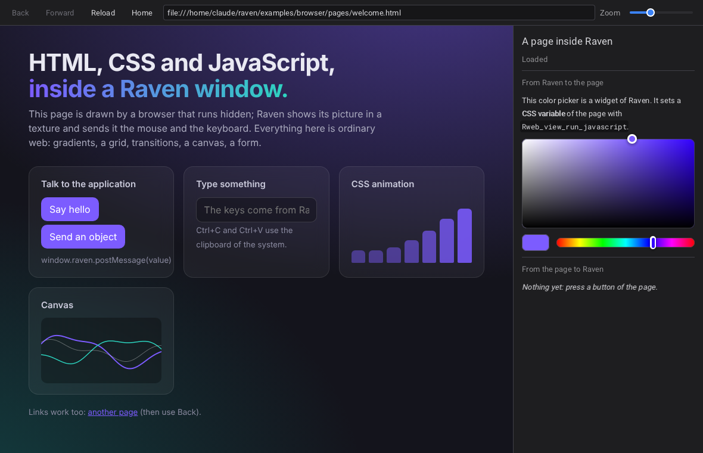

# Web pages: raven_web

`raven_web` is a separate, optional library that shows web pages (HTML, CSS,
JavaScript) inside a Raven interface. Raven does not depend on it; an
application that wants it links it next to Raven:

```cmake
target_link_libraries(app PRIVATE raven::raven raven::web)   # option RAVEN_BUILD_WEB
```

```c
#include <raven_web.h>

Rweb_register_xml();                              /* once after Rinit: <WebView> becomes a tag */
Rid view = Rweb_view_create();                    /* or from code */
Rweb_view_load_url(view, "https://example.org");
```

```xml
<WebView Name="docs" Url="https://example.org" Slot.Fill="1" OnChanged="docs.navigated"/>
<WebView Source="pages/help.html"/>
<WebView><![CDATA[<h1>Hello</h1><p>From <b>HTML</b>.</p>]]></WebView>
```



*`examples/browser`: the page is ordinary web (gradients, a grid, a canvas
animated by JavaScript); the bar above it and the panel on its right are
widgets of Raven. The color picker sets a CSS variable of the page; the
buttons of the page send messages to the application.*

## How it works, and what that implies

`raven_web` does not contain a browser. It starts one that is **already
installed** (any browser of the Chromium family: Microsoft Edge, which comes
with Windows 10 and 11, Google Chrome, Chromium, Brave, Vivaldi), hidden, in
its own process, and talks to it through a pipe with the DevTools protocol:

- the browser sends a picture of the page each time it changes; the view
  shows it in a texture, as any image of the interface (it can be clipped,
  scrolled, animated, put under glass, inside a node of a graph);
- the view sends the mouse, the keys and the text it receives;
- scripts are run in the page, and the page sends messages back.

What follows from that:

| | |
|---|---|
| the engine | the real one, up to date, with nothing to build or ship: the library is about 3 000 lines of C, 70 KB once built |
| a browser must be installed | `Rweb_is_available()` tells. Without one a view shows a message instead of a page, and everything stays safe to call |
| pages are pictures | they arrive a frame or two after what they show; smooth for documents and tools, not for a game. `Rweb_view_set_frames(view, R_WEB_FRAMES_JPEG, 80)` makes them lighter for pages that move a lot (PNG, the default, keeps text sharp) |
| one browser for all the views | it starts with the first view (a fraction of a second) and stops when the last one is deleted |
| its own profile | a temporary folder, deleted when the browser stops: no cookies or history of the user, and nothing kept. `Rweb_set_profile_folder` gives it a lasting one |
| not available | the cursor does not change over links; file choosers, downloads, printing, video capture devices and other things that need a window of the browser; `alert` / `confirm` / `prompt` are accepted at once so that the page goes on; a link that asks for a new window opens in the view |
| the clipboard | Ctrl+C, Ctrl+X and Ctrl+V carry text between the page and the clipboard of the system |

The browser is started with switches that keep it from talking to anything
but the sites the application shows: no update, no report, no account, no
messaging service, no safe-browsing lists. With Chromium 141 its own network
log shows no request of its own left (`RAVEN_WEB_ARGUMENTS="--log-net-log=file.json"`
lets you check with yours). Other browsers and other versions have services
of their own; if that matters, look at what yours does.

Raven must be built with its image decoder (`RAVEN_WITH_STB_IMAGE`, on by
default): the pictures of the pages are PNG or JPEG.

## Finding the browser

In this order: `Rweb_set_browser_path(path)`; the environment variable
`RAVEN_WEB_BROWSER`; then the usual places (`Program Files` and the local
application data on Windows, starting with Edge; the `PATH` on Linux:
`chromium`, `chromium-browser`, `google-chrome`, `microsoft-edge`,
`brave-browser`...; `/Applications` on macOS). `Rweb_get_browser_path()`
tells which one was found.

`Rweb_set_browser_arguments("--proxy-server=localhost:8080")` adds switches
to its command line (the environment variable `RAVEN_WEB_ARGUMENTS` does the
same). On Unix, a browser started by the user `root` is told `--no-sandbox`,
because it refuses to start otherwise; the variable `RAVEN_WEB_NO_SANDBOX`
does it for anyone (containers).

## The view

| | |
|---|---|
| `Rweb_view_load_url`, `_load_file`, `_load_html(view, html, base_url)` | what it shows. HTML given as text is written into an empty page; its scripts run |
| `Rweb_view_reload`, `_stop`, `_go_back`, `_go_forward`, `_can_go_back`, `_can_go_forward` | the history |
| `Rweb_view_get_url`, `_get_title`, `_is_loading`, `_is_ready`, `_get_error` | its state |
| `Rweb_view_set_zoom(view, 1.25)` | the size of the content |
| `Rweb_view_get_texture` | the picture of the page, to draw it somewhere else as well |
| `Rweb_view_set_event_callback` | `R_WEB_EVENT_NAVIGATED`, `_TITLE`, `_LOADING`, `_LOADED`, `_FAILED`. The action of the widget (`OnChanged`) fires when the address changes |

It is a widget like the others (size, slot, visibility, focus, tooltip...).

| XML attribute | |
|---|---|
| `Url` | an address |
| `Source` | a file, relative to the document |
| `Html`, or the text of the element | HTML |
| `Zoom` | |
| `Frames`, `Quality` | `Png` or `Jpeg`, 1..100 |

## JavaScript, both ways

```c
static void on_result(Rid view, const char* result, const char* error, void* user) {
    /* result is JSON: "42", "\"text\"", "{\"a\":1}", "null"; NULL when the script failed (see error) */
}
Rweb_view_run_javascript(view, "document.title", on_result, NULL);
Rweb_view_run_javascript(view, "fetch('/api').then(r => r.json())", on_result, NULL);   /* promises are awaited */

static void on_message(Rid view, const char* message, void* user) { ... }
Rweb_view_set_message_callback(view, on_message, NULL);
```

```js
window.raven.postMessage("saved");            // a string arrives as it is
window.raven.postMessage({ id: 3, ok: true }) // anything else as JSON
```

Commands given before the view is ready (the browser takes a moment to
start) wait and are sent in order.

## For tags of your own

`raven_web` uses nothing but the public functions of Raven; three of them
exist for libraries like it, and work for any widget made by code:

| | |
|---|---|
| `Rxml_register_tag(tag, create, set_attribute, user)` | gives a tag to a widget built by code, with attributes of its own |
| `Rwidget_set_destroy_callback` | told when the widget is gone, to release what belonged to it |
| `Rimage_decode` | a picture file in memory to RGBA pixels, on any thread |
| `Rxml_resolve_path` | the path of a file named in the document being loaded |

## Troubleshooting

`RAVEN_WEB_TRACE=1` prints every message of the browser; `RAVEN_WEB_DEBUG=1`
lets its own error output through.

## What was tested

On Linux with Chromium 141: `test_web` loads pages from text and from
files, checks titles, addresses and history, runs scripts (values, objects,
promises, errors), clicks a button of a page and types in a field through
the events of a Raven window, and runs two views at once; thirty runs in a
row passed, and it is clean under AddressSanitizer and ThreadSanitizer.
`examples/browser` was run with the Vulkan renderer.

**The Windows part (`web/src/web_win32.c`: starting the browser with its
pipes, the job that ties it to the application, finding Edge and Chrome) has
never been run**: it passes a syntax check against the Windows headers, no
more. Edge and Chrome themselves were not tried, only Chromium.
